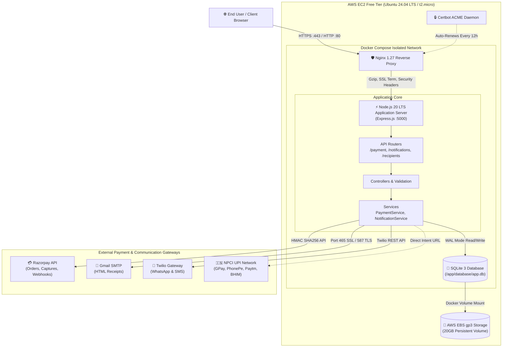
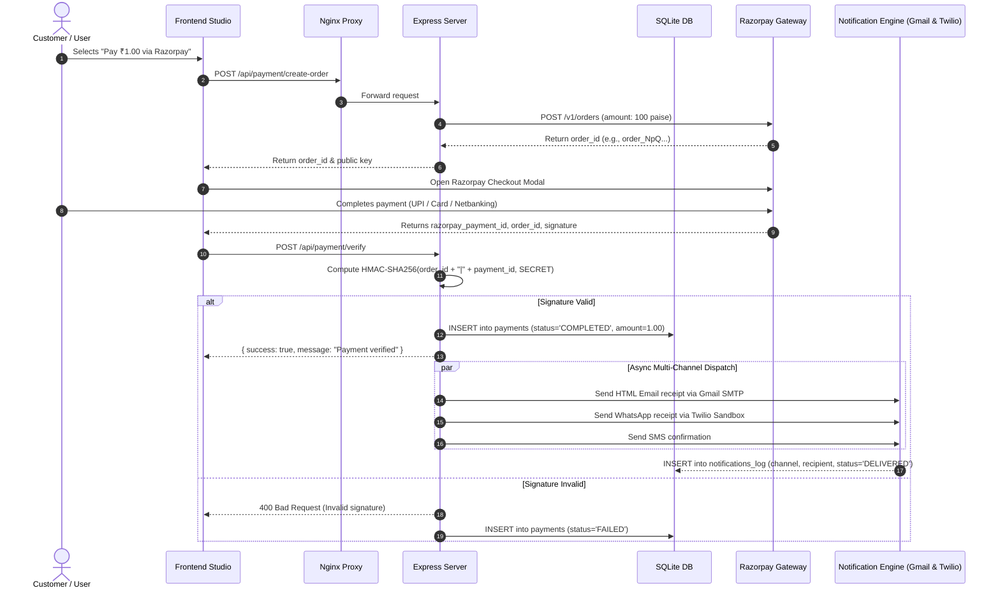
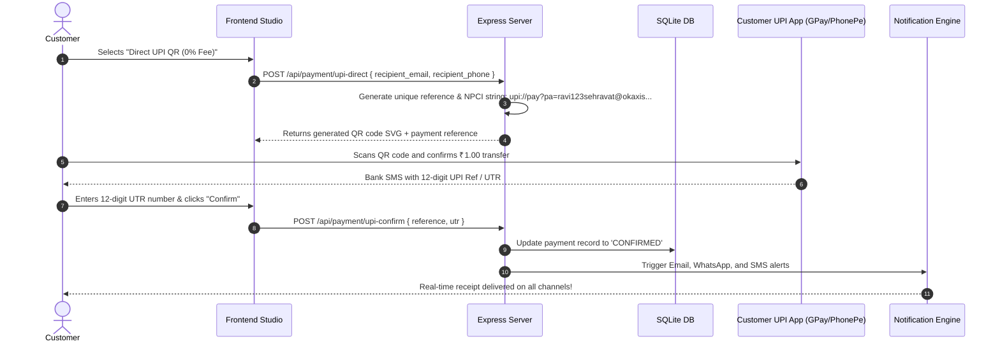
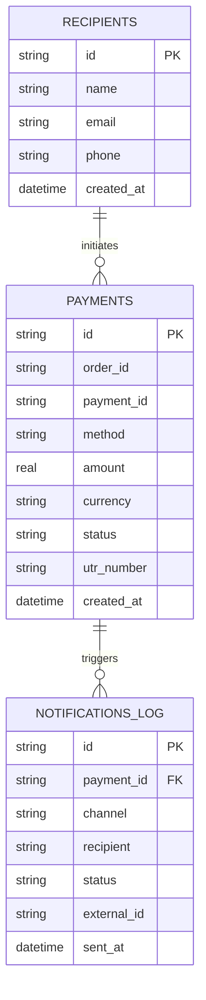

# 🏗️ System Architecture & Engineering Design

This document details the architecture, component relationships, request lifecycle, data flow, and scaling roadmap for **QuickPay & Notify Studio**.

---

## 🏛️ System Overview

QuickPay & Notify Studio is built as a production-hardened micro-monolith designed to run within the constraints of the **AWS Free Tier (t2.micro / t3.micro with 1GB RAM)** while delivering high throughput, sub-50ms API responses, zero data loss, and multi-channel redundancy.

---

## 🔁 Request Lifecycle & Payment Flows

### 1. Razorpay ₹1 Payment & Auto-Notification Flow
The sequence below illustrates the end-to-end payment creation, cryptographic signature verification, database persistence, and multi-channel notification dispatch.

---

### 2. Direct NPCI UPI QR Fallback Flow (0% Fee, Zero KYC)
For scenarios where merchant onboarding is pending or users want 100% of the funds settled directly to their personal bank account:

---

## 🗄️ Database Architecture & Data Integrity

The application utilizes **SQLite 3** operating in **WAL (Write-Ahead Logging)** mode. SQLite provides serverless simplicity, zero memory overhead, and lightning-fast local reads/writes without needing a standalone MySQL or PostgreSQL daemon.

### WAL Mode Performance Benefits:
- **Concurrent Reads and Writes**: Readers do not block writers, and writers do not block readers.
- **ACID Durability**: Transactions are written to the `-wal` log file sequentially before atomic checkpointing.
- **Low Memory Footprint**: Uses only 5–15 MB of RAM compared to 150–300 MB for MySQL/PostgreSQL, making it perfect for 1GB RAM EC2 instances.

### Core Database Entities:

---

## 🛡️ Security Architecture

1. **Non-Root Execution**:
   - The Node.js application container runs under the dedicated `node` user (UID 1000), preventing container breakout exploits.
2. **Reverse Proxy Shield**:
   - Nginx handles all public traffic on port 80 and 443. The Node.js application is never directly exposed to the internet.
3. **Hardened HTTP Headers**:
   - `Content-Security-Policy (CSP)` tuned for Razorpay and Google Fonts.
   - `X-Frame-Options: SAMEORIGIN` prevents clickjacking.
   - `X-Content-Type-Options: nosniff` stops MIME-type sniffing.
   - `HSTS (HTTP Strict Transport Security)` enforces TLS across subdomains.
4. **Cryptographic Verification**:
   - Razorpay signatures are verified using server-side HMAC-SHA256 digests (`crypto.createHmac('sha256', secret)`).
   - Secret tokens are stored strictly in environment variables and never logged.
5. **UFW & Fail2Ban**:
   - Host firewall drops all unapproved incoming ports. Only 22, 80, and 443 are allowed.

---

## 📈 Scalability Roadmap (From Free Tier to Millions)

| Stage | Infrastructure Tier | Target Scale | Architecture Changes |
| :--- | :--- | :--- | :--- |
| **Phase 1 (Current)** | AWS Free Tier (`t2.micro` / `t3.micro`) | 1 – 10,000 req/day | In-container Nginx, SQLite in WAL mode, direct SMTP/Twilio calls. Costs: **$0.00/mo**. |
| **Phase 2** | AWS `t4g.small` + Amazon RDS PostgreSQL | 10k – 100k req/day | Migrate SQLite to managed PostgreSQL (RDS Free Tier), implement Redis for BullMQ asynchronous notification queuing. |
| **Phase 3** | AWS ECS Fargate + CloudFront CDN + S3 | 100k – 1M+ req/day | Decouple frontend to S3/CloudFront; run stateless backend containers on ECS Fargate with Auto-Scaling; AWS SES for high-volume email. |
| **Phase 4** | Multi-Region Active-Active | Enterprise Global | Global Accelerator, Multi-AZ Aurora PostgreSQL, Kafka event bus for notifications. |
