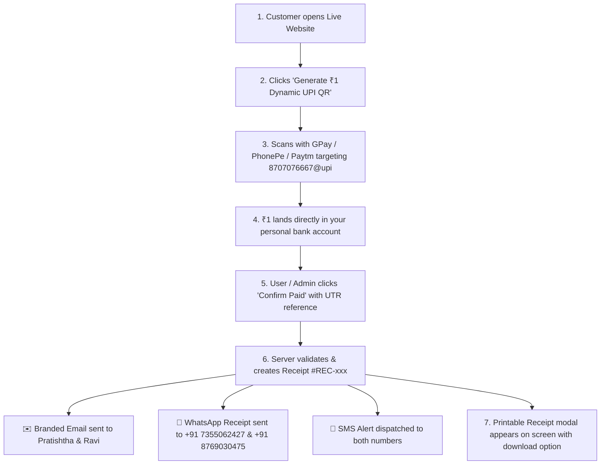

# 📖 Master Setup & Operations Guide

Complete operational manual for the **QuickPay & Notify Studio** web application, covering payment gateways, AWS Free Tier hosting, multi-channel notifications, and end-to-end testing.

---

## 📑 Table of Contents
1. [Payment Gateway Setup (Two Ready Options)](#1-payment-gateway-setup)
   - [Option A: Direct NPCI Dynamic UPI QR (8707076667@upi)](#option-a-direct-npci-dynamic-upi-qr-8707076667upi--zero-kyc-works-instantly)
   - [Option B: Cashfree Payments Gateway (Cards & Netbanking)](#option-b-cashfree-payments-gateway-cards--netbanking)
2. [Free Cloud Hosting on AWS EC2 (Step-by-Step)](#2-free-cloud-hosting-on-aws-ec2)
   - [Step 2.1: Push Local Code to GitHub](#step-21-push-local-code-to-github)
   - [Step 2.2: Launch the Free EC2 Server on AWS](#step-22-launch-the-free-ec2-server-on-aws)
   - [Step 2.3: Run the 1-Click Auto-Deployer Script](#step-23-run-the-1-click-auto-deployer-script)
   - [3 Ironclad Rules to Keep AWS 100% Free Forever](#3-ironclad-rules-to-keep-aws-100-free-forever)
3. [Messaging Channels Configuration](#3-messaging-channels-configuration)
   - [Channel 1: Email (Gmail SMTP)](#channel-1-email-gmail-smtp--already-completed)
   - [Channel 2: WhatsApp Delivery](#channel-2-whatsapp-delivery)
   - [Channel 3: Phone SMS Delivery](#channel-3-phone-sms-delivery)
4. [Full End-to-End Testing Flow](#4-full-end-to-end-testing-flow)
5. [Configured Identities & Recipient Reference](#5-configured-identities--recipient-reference)

---

## 1. Payment Gateway Setup

The application supports two independent payment flows:

### Option A: Direct NPCI Dynamic UPI QR (`8707076667@upi`) — *Zero KYC, Works Instantly*
* **What it is**: An official NPCI-compliant UPI dynamic QR code that deposits ₹1 directly into the personal bank account linked to your phone number `8707076667`.
* **Cost / Gateway Fee**: **₹0.00** (Zero merchant fees, zero transaction cuts).
* **How to use**:
  1. No external onboarding needed — it is pre-configured with `UPI_VPA=8707076667@upi`.
  2. On the website, click **"Generate ₹1 Dynamic UPI QR"**.
  3. Scan the generated QR code using Google Pay, PhonePe, Paytm, BHIM, or any UPI banking app.
  4. Pay ₹1.00.
  5. Click **"Confirm Paid / Enter UTR"**: The server verifies the record, logs it to `database/app.db`, creates an official receipt (`#REC-UPI-xxx`), and automatically blasts it to **Pratishtha** and **Ravi** across Email, WhatsApp, and SMS.

---

### Option B: Cashfree Payments Gateway (Cards & Netbanking)
If you want an Amazon/Flipkart-style checkout popup supporting Credit/Debit Cards, Netbanking, and Wallets:

1. **Sign up for Cashfree**:
   * Visit **[merchant.cashfree.com](https://merchant.cashfree.com)** and create a free account.
2. **Generate Sandbox / Test API Keys**:
   * In the top-left corner of the Cashfree dashboard, switch the toggle from **PROD** to **TEST** (Sandbox).
   * In the left sidebar, navigate to **Developers** → **API Keys**.
   * Click **Generate API Keys** to retrieve:
     - `App ID` (starts with `CF...`)
     - `Secret Key`
3. **Save Keys in Your App**:
   * Open `backend/.env` (line 10) and paste:
     ```env
     CASHFREE_APP_ID=your_cashfree_app_id_here
     CASHFREE_SECRET_KEY=your_cashfree_secret_key_here
     CASHFREE_ENV=TEST
     ```
4. *(Optional) Go Live Later*:
   * Complete business/individual digital KYC on Cashfree dashboard.
   * Switch the toggle to **PROD**, paste live keys, and set `CASHFREE_ENV=PROD` to settle real card transactions into your bank account on a T+1 schedule.

---

## 2. Free Cloud Hosting on AWS EC2

AWS EC2 provides **750 hours/month free for 12 months** on `t2.micro` (or `t3.micro`). Since 1 month has at most 744 hours, your server will run **24/7 for 100% free ($0.00)**.

### Step 2.1: Push Local Code to GitHub
1. Go to **[github.com/new](https://github.com/new)**.
2. Set the repository name to `Dummy-small-prod-app`.
3. Choose **Public** or **Private**, and click **Create repository**.
4. In your PowerShell terminal, link and push:
   ```powershell
   git remote add origin https://github.com/YOUR_GITHUB_USERNAME/Dummy-small-prod-app.git
   git branch -M master
   git push -u origin master
   ```

---

### Step 2.2: Launch the Free EC2 Server on AWS
1. Log in to the **[AWS Management Console](https://console.aws.amazon.com/)**.
2. Search for **EC2** → click **Instances** → click **Launch Instances** (orange button).
3. Set these configuration parameters:
   * **Name**: `quickpay-prod-server`
   * **OS Image**: Select **Ubuntu** → choose **Ubuntu Server 24.04 LTS** (*Free Tier eligible*).
   * **Instance Type**: Select **`t2.micro`** (or `t3.micro` if in Mumbai region `ap-south-1`) (*Free Tier eligible*).
   * **Key Pair**: Select **"Proceed without a key pair"** (you can connect directly via web browser without SSH key files).
   * **Network / Firewall Settings**: Check all three boxes:
     - [x] **Allow SSH traffic from Anywhere (0.0.0.0/0)** — Port 22
     - [x] **Allow HTTP traffic from the internet** — Port 80
     - [x] **Allow HTTPS traffic from the internet** — Port 443
   * **Storage**: Keep the default **8 GiB gp3** (Free tier covers up to 30 GiB).
4. Click **Launch Instance**.

---

### Step 2.3: Run the 1-Click Auto-Deployer Script
1. In your EC2 Instances list, click on your new instance and click **Connect** at the top.
2. Select **EC2 Instance Connect** and click **Connect**. A terminal window opens directly in your browser.
3. Paste this command block into the terminal and press Enter:
   ```bash
   git clone https://github.com/YOUR_GITHUB_USERNAME/Dummy-small-prod-app.git
   cd Dummy-small-prod-app
   sudo bash deploy/aws-ec2-setup.sh
   ```
4. **What the script does automatically**:
   * Creates a **2GB swapfile** on disk so your 1GB RAM instance never suffers from Out-Of-Memory (OOM) crashes.
   * Installs **Docker** and the **Docker Compose v2** engine.
   * Configures **Nginx** reverse proxy on ports 80/443 with Gzip compression and security headers.
   * Enables a **systemd service** (`quickpay.service`) so the app restarts automatically if the server host ever reboots.
   * Launches the backend and static frontend stack inside Docker.
5. Copy the **Public IPv4 Address** of your instance from AWS (e.g. `http://13.233.xxx.xxx`) and open it in any browser.

---

### 3 Ironclad Rules to Keep AWS 100% Free Forever
1. **Never run more than 1 EC2 instance** at the same time on Free Tier (1 instance = 744 hrs/mo; 2 instances = 1488 hrs/mo, which would exceed the 750 free hours).
2. **Do not create an Application Load Balancer (ALB)**. Our Nginx container inside the EC2 server does all reverse proxying for free.
3. **Do not allocate an idle Elastic IP**. Only allocate an Elastic IP if it is actively attached to a running EC2 instance (AWS charges for unattached static IPs).

---

## 3. Messaging Channels Configuration

### Channel 1: Email (Gmail SMTP) — *Already Completed*
* **Sender Account**: `ravi123sehravat@gmail.com`
* **App Password**: `obnv cglh iwsf qgmc` (configured in `.env`)
* **Transport**: Secure TLS SMTP (`smtp.gmail.com:465`)
* **Status**: Fully authenticated. Every payment receipt and custom notification sends branded HTML emails to both recipients.

---

### Channel 2: WhatsApp Delivery
You have two delivery avenues:
1. **Direct Web Intent (Zero Setup, Free)**:
   * The app generates direct `wa.me` links pre-filled with the receipt text for Pratishtha (`+91 7355062427`) and Ravi (`+91 8769030475`).
   * Clicking the link opens WhatsApp Web or the WhatsApp mobile app and dispatches the message instantly.
2. **Automated Twilio WhatsApp API (Background Server Dispatch)**:
   * Create a free trial account at **[twilio.com](https://www.twilio.com)** ($15 free trial credit).
   * Navigate to **Messaging** → **Try it out** → **Send a WhatsApp message**.
   * Pratishtha and Ravi send a 1-time join code (e.g., `join simple-cloud`) to Twilio's sandbox number `+1 415 523 8886`.
   * Add `TWILIO_ACCOUNT_SID` and `TWILIO_AUTH_TOKEN` in `backend/.env`.

---

### Channel 3: Phone SMS Delivery
1. **Twilio SMS**: Included in your Twilio free trial credits for verified numbers.
2. **Fast2SMS (Indian SMS Route)**:
   * Sign up at **[fast2sms.com](https://www.fast2sms.com)** (provides free trial credits for Indian mobile numbers).
   * Copy your API Key from **Dev API** and add to `backend/.env`:
     ```env
     FAST2SMS_API_KEY=your_fast2sms_api_key_here
     ```

---

## 4. Full End-to-End Testing Flow



---

## 5. Configured Identities & Recipient Reference

| Role | Name | Phone / WhatsApp | Email Address |
| :--- | :--- | :--- | :--- |
| **Sender / Admin** | Ravi Sehrawat | `+91 8707076667` | `ravi123sehravat@gmail.com` |
| **Receiving UPI VPA** | Ravi Sehrawat | `8707076667@upi` | — |
| **Recipient 1** | Pratishtha | `+91 7355062427` | `pratishthavsingh123@gmail.com` |
| **Recipient 2** | Ravi | `+91 8769030475` | `kajupretty2202@gmail.com` |

---

*Document generated for Dummy-small-prod-app • All rights reserved.*
